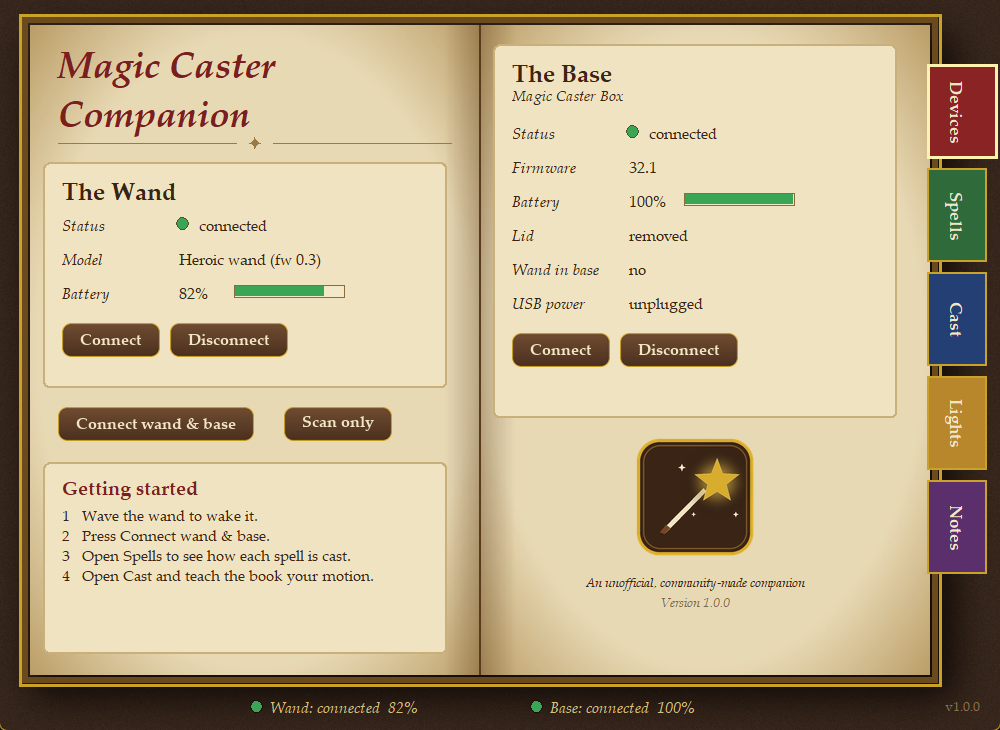
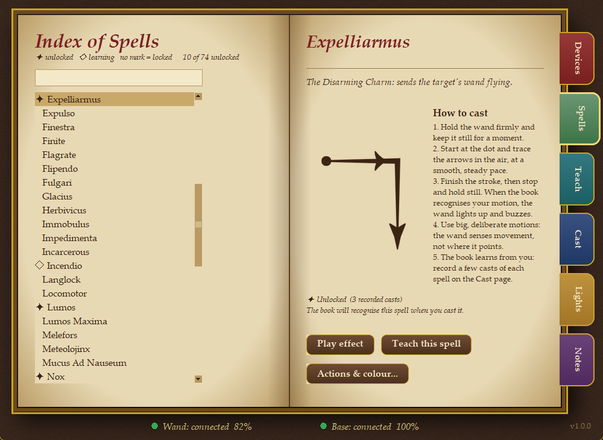
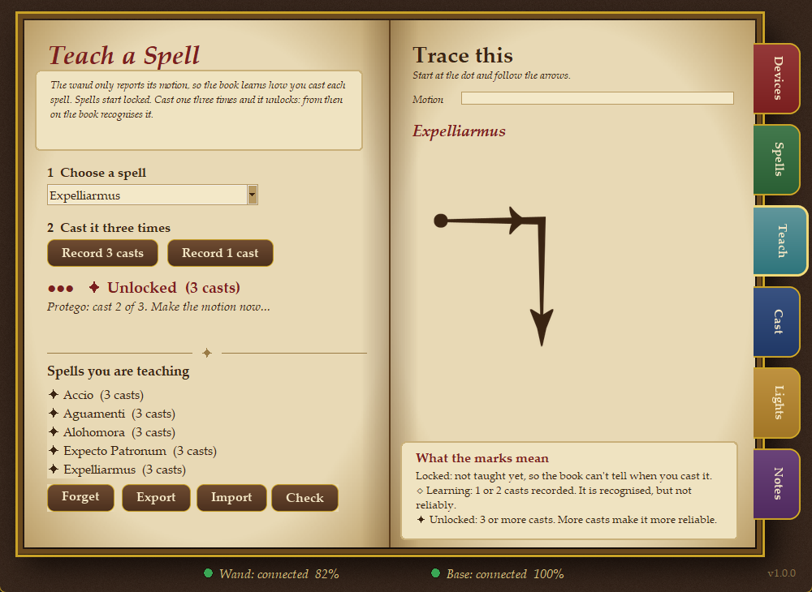
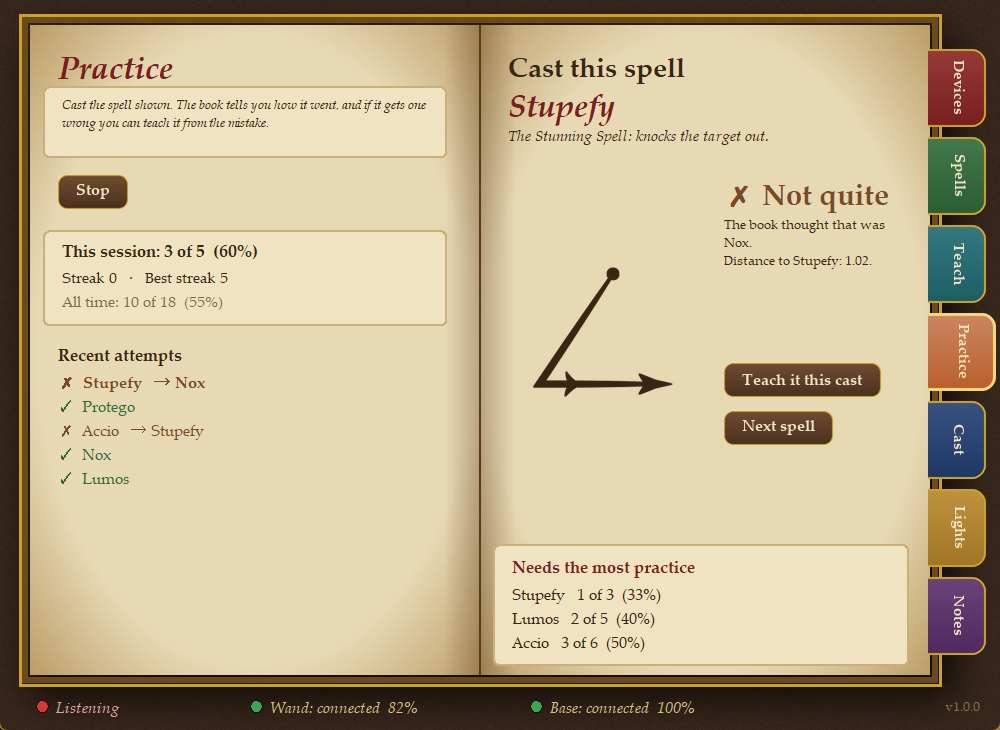

# Magic Caster Companion

An unofficial, open-source desktop spell book for the **Harry Potter Magic Caster Wand** and its **Magic Caster
Box** (the base), for people whose phone app no longer works. It talks to both devices over Bluetooth Low Energy
from a Windows PC. No firmware is changed.

> Unofficial and not affiliated with Warner Bros., the Wizarding World, or the wand's makers. See
> [THIRD_PARTY_NOTICES.md](THIRD_PARTY_NOTICES.md).





## What it does

The app looks like a spell book, with a ribbon tab for each page (or press Ctrl+1 to Ctrl+7). A status line along
the bottom always shows, with a coloured dot, whether the wand and base are connected. Hover over any button for a
hint. A soft page-turn sound plays as the pages turn (synthesised in code, so there is no audio file to ship);
turn sounds off under **Lights > Preferences**.

| Page | What's on it |
|---|---|
| **Devices** | Connect the wand and base (one button, or each on its own). Model, firmware, battery, and the base's lid, wand-in-base and USB-power state. Connects and reconnects automatically |
| **Spells** | Index of about 80 spells, each marked locked, learning or unlocked. Pick one to see its gesture diagram, a short description and how to cast it. Play its light and buzz effect, or set its colour and an **action** |
| **Teach** | Unlock a spell: pick it, then cast it three times. Shows progress, lists the spells you are teaching, and can check, export and import your casts |
| **Practice** | The app shows a spell, you cast it, and it tells you how it went. Hard spells come up more often. If the book gets one wrong you can add that cast to it with one click. Keeps a streak and per-spell accuracy |
| **Cast** | Free casting on a full two-page spread. Cast anything: the book names the spells you have unlocked, with a live motion trace, a history of recent casts, your unlocked spells, and the recognition settings |
| **Lights** | Set each LED group on the wand and the base's light, make the wand buzz, choose the page-turn sound, and set the **Background** options (tray, notifications, start with Windows) |
| **Notes** | Activity log, version, and credits |

### How spells unlock

The wand only sends raw motion data. It has no built-in spell recognition, so the book learns **your** version of
each spell. That is what "teaching" means.

| Mark | State | Meaning |
|---|---|---|
| (none) | **Locked** | You haven't recorded this spell. The book can't tell when you cast it |
| ◇ | **Learning** | 1 or 2 casts recorded. Recognised, but not reliably |
| ✦ | **Unlocked** | 3 or more casts recorded. More casts make it more reliable |

1. On the **Spells** page, look at the diagram for a spell: start at the dot and trace the arrows.
2. On the **Teach** page, pick the spell and press **Record 3 casts**. A cast that looks like a different spell is
   rejected, so one stray motion can't spoil the set. On the third cast the spell unlocks.
3. On the **Cast** page, cast anything. Recognised spells are named, the wand lights up and buzzes, and a sound
   plays. Recognition also works when another page is open, so actions fire with the app in the background.
4. **Check** (on Teach) runs a self-test of your recorded casts and tells you which spells get mixed up.
   **Auto-tune** (on Cast) sets the sensitivity limit from your own casts. **Test mode** recognises casts without
   running any actions.
5. **Export** and **Import** share your recorded casts between PCs or friends.






### Running in the background

The window's close button can keep the app running in the **system tray**, so the wand stays connected and your
spell actions keep working with the window closed. Right-click the tray icon to open the book, turn recognition
on or off, reconnect, or quit. A tooltip shows the wand and base status.

Under **Lights > Background** you can choose what the close button does, get a tray notification when a spell is
recognised while the window is hidden, and **start with Windows** (minimised to the tray). Start with Windows is
off until you switch it on, and it only adds a per-user start-up entry. Launching the app a second time just shows
the copy that is already running, because only one copy can talk to the wand.

### The wand's own recognition (★)

The wand recognises some spells by itself and reports them by name; so far Protego has been seen. When that
happens the **Cast** page and history show it (marked "wand"), it plays the same effect and runs the same action,
and the spell gets a ★ in the index. If the wand and the book both recognise the same cast it counts once
("both"); if they disagree, the wand's answer is used. The **Stream motion** switch on the Cast page turns motion
streaming off, so only the wand's own recognition is active (spells you taught then can't be recognised). The
Cast page counts how many spells the wand has named, with streaming on and off, so you can see whether both work
at the same time.

### Actions

A recognised spell can do more than light the wand. Press **Actions & colour...** on a spell to choose its light
colour and an action:

| Action | Example |
|---|---|
| Press keys | `ctrl+shift+m`, `f5`, `win+d`, `playpause`, `volup` |
| Run program | `notepad`, or `"C:\Games\game.exe" -windowed` |
| Open web page | `https://example.com` |
| Send webhook (POST) | An http(s) URL. Receives `{"spell": "lumos", "source": "magic-caster-companion"}`, handy for Home Assistant or IFTTT |
| Play sound file | A `.wav` file |


Actions run on your PC with your permissions, so only set ones you trust. Use **Test** in the dialog to try one.

## Run it

Requires Windows 10/11 with Bluetooth LE, and Python 3.10+.

```bash
pip install -r requirements.txt
python app.py
```

Wake the wand with a wave, then press **Connect wand & base**.

A standalone EXE can be built with PyInstaller (add `--exclude-module numpy` if numpy is installed):

```bash
pip install pyinstaller
python -m PyInstaller --noconfirm --onefile --windowed --name MagicCasterCompanion --icon assets/icon.ico --collect-submodules bleak --hidden-import pystray._win32 --add-data "assets;assets" app.py
```

If a window is already connected to a device (for example a second copy of this app), the device stops
advertising and cannot be found. Close the other window first.

Settings, recorded casts, colours and actions are stored in `%APPDATA%\MagicCasterCompanion`.

## Using the library

`mcwand.py` is a small `bleak` library you can use on its own. See `demo.py`.

```python
from mcwand import Wand, scan

found = await scan()
async with Wand(found["wand"]["address"]) as w:
    await w.led(0, 255, 0, 0)   # tip LED red
    await w.buzz(300)
    w.on_imu = lambda samples: print(samples[-1])
    await w.imu_start()
```

## How it works

- Both devices are Bluetooth LE peripherals with a custom service (`57420001-…`) holding a command characteristic
  (`…0002`, write) and a notify characteristic (`…0003`). Subscribe to notifications first, or the device drops
  the link.
- The wand streams raw gyroscope and accelerometer samples. In testing it never reported a recognised spell
  itself, so `gestures.py` segments each swish and matches it against your recorded casts with dynamic time
  warping. Each cast's rotation strength is normalised first, so the shape of a motion is compared, not how hard
  you cast it (hard and gentle casts of the same spell look alike).
- The four `0x10` touch-sensor events, LED, buzz, motion and base status messages are implemented. See `mcwand.py`.

## Project layout

| File | What it does |
|---|---|
| `app.py` | Entry point and the `App` window (state, drawing surface, book chrome) |
| `pages/` | One module per page: `devices`, `spells`, `teach`, `practice`, `cast`, `lights`, `notes` |
| `connection.py` | Finding, connecting to and reconnecting the wand and base |
| `casting.py` | Turning wand motion and wand reports into recognised casts, effects and actions |
| `shell.py` | System tray, running in the background, closing the window |
| `common.py` | Shared imports, layout constants and helpers |
| `mcwand.py` | The Bluetooth library for the wand and base |
| `gestures.py`, `practice.py` | Gesture matching and practice logic |
| `actions.py`, `sounds.py`, `settings.py` | What a spell can trigger, synthesised sounds, saved settings |
| `ui_kit.py`, `spells_data.py`, `winintegration.py` | Visual building blocks, the spell catalogue, Windows integration |

## Development

```bash
pip install -r requirements.txt pytest
python -m pytest -q tests
```

`python app.py --shots <folder>` saves a screenshot of every page without connecting to any device.
`MagicCasterCompanion.exe --selftest <file>` runs a headless Bluetooth check and writes the result to a file.

## Status and limits

- Tested with one Heroic wand (model `WBMC22G1SHRW`, firmware 0.3) and its base (firmware 32.1) on Windows 11.
- Gesture recognition needs a few recorded casts per spell. It is tested on synthetic motion and in simulation,
  and may need tuning for real casting. Use the sensitivity slider, Check and Auto-tune.
- The spell diagrams show the shape to trace; there is no pre-trained recogniser.
- **Firmware updates are deliberately not implemented.** The devices expose a Nordic DFU service, but flashing
  unknown firmware can permanently brick a device. The library also avoids the factory-unlock and calibration
  commands.

## Credits

The message formats come from the MIT-licensed
[hass-magic-caster-wand](https://github.com/eigger/hass-magic-caster-wand) project by eigger, which also supplied
the spell gesture diagrams. Thank you.

## Licence

MIT. See [LICENSE](LICENSE) and [THIRD_PARTY_NOTICES.md](THIRD_PARTY_NOTICES.md).
