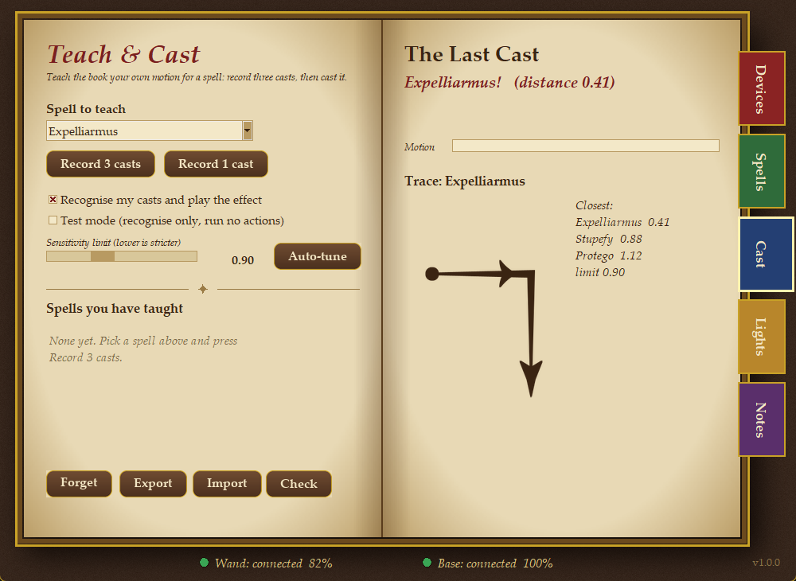
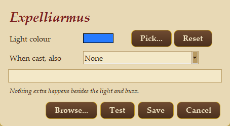

# Magic Caster Companion

An unofficial, open-source desktop spell book for the **Harry Potter Magic Caster Wand** and its **Magic Caster
Box** (the base), for people whose phone app no longer works. It talks to both devices over Bluetooth Low Energy
from a Windows PC. No firmware is changed.

> Unofficial and not affiliated with Warner Bros., the Wizarding World, or the wand's makers. See
> [THIRD_PARTY_NOTICES.md](THIRD_PARTY_NOTICES.md).


## What it does

The app looks like a spell book, with a ribbon tab for each page (or press Ctrl+1 to Ctrl+5). A status line along
the bottom always shows, with a coloured dot, whether the wand and base are connected. Hover over any button for a
hint.

| Page | What's on it |
|---|---|
| **Devices** | Connect the wand and base (one button, or each on its own). Model, firmware, battery, and the base's lid, wand-in-base and USB-power state. Connects and reconnects automatically |
| **Spells** | Index of about 80 spells. Pick one to see its gesture diagram, a short description and how to cast it. Play its light and buzz effect, or set its colour and an **action** |
| **Cast** | Teach the book your own motion for each spell, then cast. See how close each spell was, tune the sensitivity, and check your recorded casts |
| **Lights** | Set each LED group on the wand and the base's light, make the wand buzz, and set preferences |
| **Notes** | Activity log, version, and credits |

### Casting spells

The wand sends raw motion data, so the book learns **your** version of each spell:

1. On the **Spells** page, look at the diagram for a spell: start at the dot and trace the arrows.
2. On the **Cast** page, pick the spell and press **Record 3 casts**. A cast that looks like a different
   spell is rejected, so one stray motion can't spoil the set.
3. Leave *Recognise my casts* ticked and cast. The spell name glows on the page, the wand lights up and buzzes,
   and a sound plays.
4. **Check** runs a self-test of your recorded casts and tells you which spells get mixed up. **Auto-tune** sets the
   sensitivity limit from your own casts. **Test mode** recognises casts without running any actions.
5. **Export** and **Import** share your recorded casts between PCs or friends.



### Actions

A recognised spell can do more than light the wand. Press **Actions & colour...** on a spell to choose its light
colour and an action:

| Action | Example |
|---|---|
| Press keys | `ctrl+shift+m`, `f5`, `win+d`, `playpause`, `volup` |
| Run program | `notepad`, or `"C:\Games\game.exe" -windowed` |
| Open web page | `https://example.com` |
| Send webhook (POST) | An http(s) URL. Receives `{"spell": "lumos", "source": "magic-caster-companion"}`, handy for Home Assistant or IFTTT |
| Play sound file | A `.wav` file |



Actions run on your PC with your permissions, so only set ones you trust. Use **Test** in the dialog to try one.

## Run it

Requires Windows 10/11 with Bluetooth LE, and Python 3.10+.

```bash
pip install -r requirements.txt
python app.py
```

Wake the wand with a wave, then press **Connect wand & base**.

A standalone EXE can be built with PyInstaller:

```bash
pip install pyinstaller
python -m PyInstaller --noconfirm --onefile --windowed --name MagicCasterCompanion --icon assets/icon.ico --collect-submodules bleak --add-data "assets;assets" app.py
```

If a window is already connected to a device (for example a second copy of this app), the device stops
advertising and cannot be found. Close the other window first.

Settings, recorded casts, colours and actions are stored in `%APPDATA%\MagicCasterCompanion`.

## Using the library

`mcwand.py` is a small `bleak` library you can use on its own. See `demo.py`.

```python
from mcwand import Wand, scan

found = await scan()
async with Wand(found["wand"]["address"]) as w:
    await w.led(0, 255, 0, 0)   # tip LED red
    await w.buzz(300)
    w.on_imu = lambda samples: print(samples[-1])
    await w.imu_start()
```

## How it works

- Both devices are Bluetooth LE peripherals with a custom service (`57420001-…`) holding a command characteristic
  (`…0002`, write) and a notify characteristic (`…0003`). Subscribe to notifications first, or the device drops
  the link.
- The wand streams raw gyroscope and accelerometer samples. In testing it never reported a recognised spell
  itself, so `gestures.py` segments each swish and matches it against your recorded casts with dynamic time
  warping.
- The four `0x10` touch-sensor events, LED, buzz, motion and base status messages are implemented. See `mcwand.py`.

## Development

```bash
pip install -r requirements.txt pytest
python -m pytest -q tests
```

`python app.py --shots <folder>` saves a screenshot of every page without connecting to any device.
`MagicCasterCompanion.exe --selftest <file>` runs a headless Bluetooth check and writes the result to a file.

## Status and limits

- Tested with one Heroic wand (model `WBMC22G1SHRW`, firmware 0.3) and its base (firmware 32.1) on Windows 11.
- Gesture recognition needs a few recorded casts per spell. It is tested on synthetic motion and in simulation,
  and may need tuning for real casting. Use the sensitivity slider, Check and Auto-tune.
- The spell diagrams show the shape to trace; there is no pre-trained recogniser.
- **Firmware updates are deliberately not implemented.** The devices expose a Nordic DFU service, but flashing
  unknown firmware can permanently brick a device. The library also avoids the factory-unlock and calibration
  commands.

## Credits

The message formats come from the MIT-licensed
[hass-magic-caster-wand](https://github.com/eigger/hass-magic-caster-wand) project by eigger, which also supplied
the spell gesture diagrams. Thank you.

## Licence

MIT. See [LICENSE](LICENSE) and [THIRD_PARTY_NOTICES.md](THIRD_PARTY_NOTICES.md).
